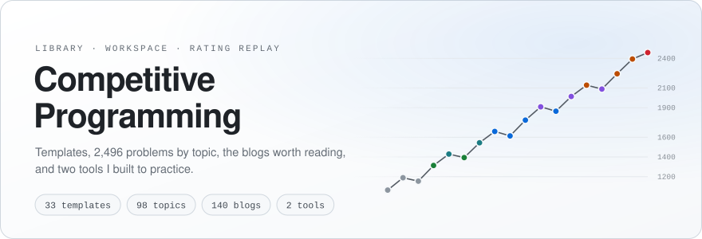
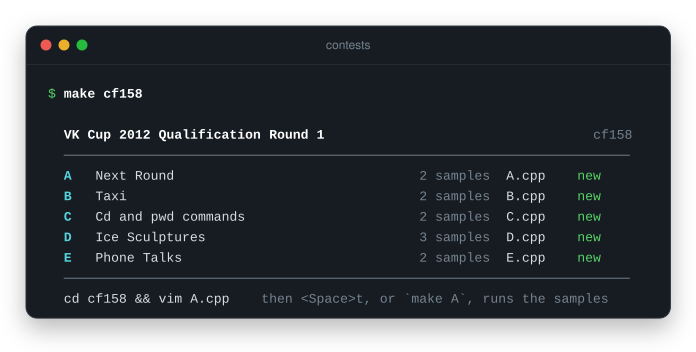
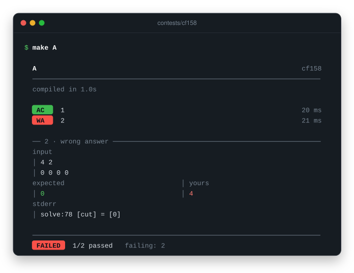
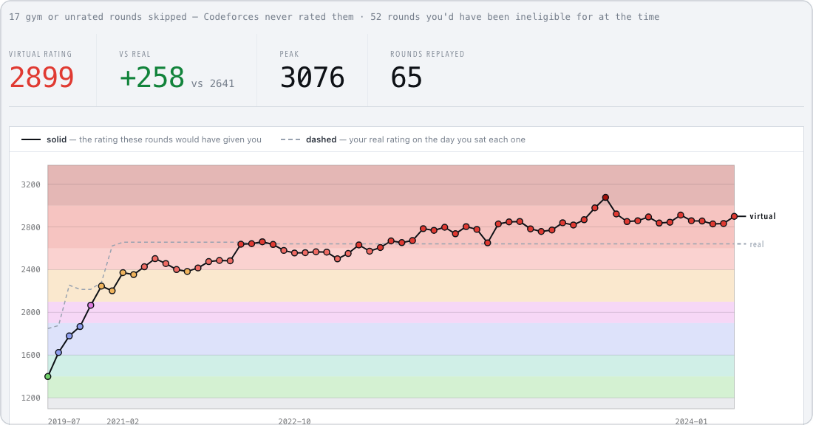

<picture>
  <source media="(prefers-color-scheme: dark)" srcset=".github/readme/hero-dark.svg">
  
</picture>

<p align="center">
  Here I list the best resources I found during my journey in competitive programming,<br>
  plus two tools I built along the way. I hope you like it :)
</p>

<p align="center">
  <a href="#tools">Tools</a> &nbsp;·&nbsp;
  <a href="#templates">Templates</a> &nbsp;·&nbsp;
  <a href="#problems-by-topic">Problems</a> &nbsp;·&nbsp;
  <a href="#blogs">Blogs</a> &nbsp;·&nbsp;
  <a href="#books">Books</a> &nbsp;·&nbsp;
  <a href="#useful-links">Links</a>
</p>

## What's inside

| Folder | What you'll find |
|:--|:--|
| [`contests/`](contests/) | A contest workspace: one command fetches a Codeforces or AtCoder contest, one key runs the samples |
| [`vrating/`](vrating/) | The rating you'd have if every virtual contest you've ever done had counted |
| [`Algorithms_templates/`](Algorithms_templates/) | 33 C++ templates for known algorithms |
| [`Collection_of_problems/`](Collection_of_problems/) | 2,496 problems sorted into 98 topics |
| [`Interesting_blogs/`](Interesting_blogs/) | 140 blog posts worth reading, in 8 categories |
| [`Books/`](Books/) | Two advanced books and a roadmap for starting out |
| [`Probability_problems_solutions/`](Probability_problems_solutions/) | Three probability problems, solved |

## Tools

Two things I built for myself. Each folder has its own README with the details.

### contests

Type the contest ID and start solving. `make cf2268` or `make abc370` creates a folder for that Codeforces or AtCoder contest, with one file per problem copied from my template and every sample downloaded.

<p align="center">
  
</p>

Then <kbd>Space</kbd> <kbd>t</kbd> in vim saves the file, compiles it and runs every sample in a split beside the code. `make A` does the same from the shell.

<p align="center">
  
</p>

- **Verdicts you already know:** `AC`, `WA`, `RE`, `TLE` and `CE`, with the time of each sample.
- **Failures explained:** the input, expected and your output side by side, and whatever you printed with `trace()`.
- **Your own tests:** drop an `.in` file next to the samples; the `.out` is optional.
- **Safe to re-run:** it never overwrites a solution that already exists.

```bash
cd contests
make cf2268    # Codeforces
make abc370    # AtCoder
```

[Read the guide →](contests/README.md)

### vrating

**The rating you'd have if every virtual contest you've ever done had counted.** You sit a virtual round on Codeforces, get a rank, and nothing happens. vrating replays those rounds against the field that actually sat them, chains each result into the next, and draws the career you'd have had.

<p align="center">
  
</p>

- **Replays your virtual rounds as if they were real,** scored against every rated participant of that round.
- **Tells you what to upsolve:** the problems most people at your level solved and you didn't, grouped by tag.

```bash
cd vrating
make dev
```

[Read more →](vrating/README.md)

## Library

### Templates

As I solved more and more problems, I wrote templates for known algorithms. Before you copy and paste the code, be sure to understand what it does ~~except for Flows lol~~.

| Area | Templates |
|:--|:--|
| **Graphs** | [Dijkstra](Algorithms_templates/Dijkstra.cpp)&nbsp;· [Dinic max flow](Algorithms_templates/Dinic.cpp)&nbsp;· [MST](Algorithms_templates/MST.cpp)&nbsp;· [SCC](Algorithms_templates/SCC.cpp)&nbsp;· [Toposort](Algorithms_templates/Toposort.cpp)&nbsp;· [LCA](Algorithms_templates/LCA.cpp)&nbsp;· [Heavy-light decomposition](Algorithms_templates/HeavyLightDecomposition.cpp)&nbsp;· [Tree diameter](Algorithms_templates/Diameter%20in%20a%20tree.cpp) |
| **Data structures** | [DSU](Algorithms_templates/DSU.cpp)&nbsp;· [Segment tree](Algorithms_templates/segment_tree.cpp)&nbsp;· [Segment tree, iterative](Algorithms_templates/SegmentTree.cpp) |
| **Strings** | [Aho-Corasick](Algorithms_templates/Aho_Corasick.cpp)&nbsp;· [KMP](Algorithms_templates/kmp.cpp)&nbsp;· [Z-function](Algorithms_templates/Z_function.cpp)&nbsp;· [Manacher](Algorithms_templates/Manacher.cpp)&nbsp;· [Hashing](Algorithms_templates/Hashing.cpp) |
| **Number theory** | [Sieve](Algorithms_templates/Sieve.cpp)&nbsp;· [Linear sieve](Algorithms_templates/Linear%20Sieve%20of%20Eratostenes.cpp)&nbsp;· [Primality test](Algorithms_templates/Prime_testing.cpp)&nbsp;· [Factorization](Algorithms_templates/Factors.cpp)&nbsp;· [Divisors](Algorithms_templates/Divisors.cpp)&nbsp;· [Euler's totient](Algorithms_templates/EulerTotient.cpp)&nbsp;· [Extended GCD](Algorithms_templates/GCD_extended.cpp)&nbsp;· [Modular inverse](Algorithms_templates/Inverse%20Modular.cpp)&nbsp;· [Modular exponentiation](Algorithms_templates/Modular%20Exponentiation.cpp)&nbsp;· [Factorials and inverse factorials](Algorithms_templates/factorials%20and%20inv%20factorials.cpp) |
| **Algebra** | [FFT](Algorithms_templates/FFT.cpp)&nbsp;· [Matrix exponentiation](Algorithms_templates/Matrix%20Exponentiation.cpp) |
| **Geometry** | [Geometry primitives](Algorithms_templates/Geometry.cpp)&nbsp;· [Convex hull](Algorithms_templates/ConvexHull.cpp) |
| **Everyday** | [Header template](Algorithms_templates/Plantilla_Header.cpp)&nbsp;· [Debugger](Algorithms_templates/Debuger.cpp)&nbsp;· [Min operations to make an array equal](Algorithms_templates/Min%20operations%20decrement%20or%20increment%20to%20make%20an%20array%20equal.cpp) |

### Problems by topic

Each link contains a list of problems for that specific topic: 2,496 problems in 98 topics. This list was originally created by the user Morass in Codeforces. The small number is how many problems the topic has.

<p>
<a href="Collection_of_problems/README.md#2sat">2SAT</a>&nbsp;<sub>2</sub>&nbsp;&nbsp; <a href="Collection_of_problems/README.md#aho">aho</a>&nbsp;<sub>7</sub>&nbsp;&nbsp; <a href="Collection_of_problems/README.md#automat">automat</a>&nbsp;<sub>4</sub>&nbsp;&nbsp; <a href="Collection_of_problems/README.md#belman-ford">bellman-ford</a>&nbsp;<sub>2</sub>&nbsp;&nbsp; <a href="Collection_of_problems/README.md#bfs">bfs</a>&nbsp;<sub>19</sub>&nbsp;&nbsp; <a href="Collection_of_problems/README.md#bfs-grid">bfs-grid</a>&nbsp;<sub>14</sub>&nbsp;&nbsp; <a href="Collection_of_problems/README.md#big">big</a>&nbsp;<sub>66</sub>&nbsp;&nbsp; <a href="Collection_of_problems/README.md#binary_search">binary&nbsp;search</a>&nbsp;<sub>41</sub>&nbsp;&nbsp; <a href="Collection_of_problems/README.md#bits">bits</a>&nbsp;<sub>11</sub>&nbsp;&nbsp; <a href="Collection_of_problems/README.md#bitset">bitset</a>&nbsp;<sub>9</sub>&nbsp;&nbsp; <a href="Collection_of_problems/README.md#bridges">bridges</a>&nbsp;<sub>12</sub>&nbsp;&nbsp; <a href="Collection_of_problems/README.md#brute-force">brute-force</a>&nbsp;<sub>78</sub>&nbsp;&nbsp; <a href="Collection_of_problems/README.md#centroid">centroid</a>&nbsp;<sub>9</sub>&nbsp;&nbsp; <a href="Collection_of_problems/README.md#chess">chess</a>&nbsp;<sub>31</sub>&nbsp;&nbsp; <a href="Collection_of_problems/README.md#coloring">coloring</a>&nbsp;<sub>3</sub>&nbsp;&nbsp; <a href="Collection_of_problems/README.md#combinatorics">combinatorics</a>&nbsp;<sub>56</sub>&nbsp;&nbsp; <a href="Collection_of_problems/README.md#constructive">constructive</a>&nbsp;<sub>27</sub>&nbsp;&nbsp; <a href="Collection_of_problems/README.md#dfs">dfs</a>&nbsp;<sub>58</sub>&nbsp;&nbsp; <a href="Collection_of_problems/README.md#digits">digits</a>&nbsp;<sub>2</sub>&nbsp;&nbsp; <a href="Collection_of_problems/README.md#dijkstra">dijkstra</a>&nbsp;<sub>35</sub>&nbsp;&nbsp; <a href="Collection_of_problems/README.md#divide_conquer">divide&nbsp;conquer</a>&nbsp;<sub>5</sub>&nbsp;&nbsp; <a href="Collection_of_problems/README.md#divisors">divisors</a>&nbsp;<sub>48</sub>&nbsp;&nbsp; <a href="Collection_of_problems/README.md#dp">dp</a>&nbsp;<sub>225</sub>&nbsp;&nbsp; <a href="Collection_of_problems/README.md#dsu">dsu</a>&nbsp;<sub>48</sub>&nbsp;&nbsp; <a href="Collection_of_problems/README.md#euler_function">euler&nbsp;function</a>&nbsp;<sub>19</sub>&nbsp;&nbsp; <a href="Collection_of_problems/README.md#euler_tour">euler&nbsp;tour</a>&nbsp;<sub>6</sub>&nbsp;&nbsp; <a href="Collection_of_problems/README.md#factorization">factorization</a>&nbsp;<sub>44</sub>&nbsp;&nbsp; <a href="Collection_of_problems/README.md#fenwick">fenwick</a>&nbsp;<sub>38</sub>&nbsp;&nbsp; <a href="Collection_of_problems/README.md#fft">fft</a>&nbsp;<sub>11</sub>&nbsp;&nbsp; <a href="Collection_of_problems/README.md#flow">flow</a>&nbsp;<sub>32</sub>&nbsp;&nbsp; <a href="Collection_of_problems/README.md#flow-matching-like">flow-matching-like</a>&nbsp;<sub>9</sub>&nbsp;&nbsp; <a href="Collection_of_problems/README.md#floyd-warshall">floyd-warshall</a>&nbsp;<sub>23</sub>&nbsp;&nbsp; <a href="Collection_of_problems/README.md#friedvaldalgorithm">freivalds</a>&nbsp;<sub>2</sub>&nbsp;&nbsp; <a href="Collection_of_problems/README.md#game_theory">game&nbsp;theory</a>&nbsp;<sub>45</sub>&nbsp;&nbsp; <a href="Collection_of_problems/README.md#gauss">gauss</a>&nbsp;<sub>7</sub>&nbsp;&nbsp; <a href="Collection_of_problems/README.md#geometry">geometry</a>&nbsp;<sub>120</sub>&nbsp;&nbsp; <a href="Collection_of_problems/README.md#graph">graph</a>&nbsp;<sub>12</sub>&nbsp;&nbsp; <a href="Collection_of_problems/README.md#greedy">greedy</a>&nbsp;<sub>97</sub>&nbsp;&nbsp; <a href="Collection_of_problems/README.md#hash">hash</a>&nbsp;<sub>18</sub>&nbsp;&nbsp; <a href="Collection_of_problems/README.md#hull">hull</a>&nbsp;<sub>23</sub>&nbsp;&nbsp; <a href="Collection_of_problems/README.md#implementation">implementation</a>&nbsp;<sub>69</sub>&nbsp;&nbsp; <a href="Collection_of_problems/README.md#inclusion-exclusion">inclusion-exclusion</a>&nbsp;<sub>4</sub>&nbsp;&nbsp; <a href="Collection_of_problems/README.md#interactive">interactive</a>&nbsp;<sub>8</sub>&nbsp;&nbsp; <a href="Collection_of_problems/README.md#isomorphism">isomorphism</a>&nbsp;<sub>4</sub>&nbsp;&nbsp; <a href="Collection_of_problems/README.md#josephus">josephus</a>&nbsp;<sub>13</sub>&nbsp;&nbsp; <a href="Collection_of_problems/README.md#kmp">KMP</a>&nbsp;<sub>6</sub>&nbsp;&nbsp; <a href="Collection_of_problems/README.md#lca">lca</a>&nbsp;<sub>28</sub>&nbsp;&nbsp; <a href="Collection_of_problems/README.md#lcs_subsequence">lcs&nbsp;subsequence</a>&nbsp;<sub>13</sub>&nbsp;&nbsp; <a href="Collection_of_problems/README.md#lct">lct</a>&nbsp;<sub>6</sub>&nbsp;&nbsp; <a href="Collection_of_problems/README.md#lis">lis</a>&nbsp;<sub>16</sub>&nbsp;&nbsp; <a href="Collection_of_problems/README.md#matching">matching</a>&nbsp;<sub>40</sub>&nbsp;&nbsp; <a href="Collection_of_problems/README.md#matrix">matrix</a>&nbsp;<sub>1</sub>&nbsp;&nbsp; <a href="Collection_of_problems/README.md#matrix_exponentiation">matrix&nbsp;exponentiation</a>&nbsp;<sub>32</sub>&nbsp;&nbsp; <a href="Collection_of_problems/README.md#mcmf">mcmf</a>&nbsp;<sub>15</sub>&nbsp;&nbsp; <a href="Collection_of_problems/README.md#median">median</a>&nbsp;<sub>5</sub>&nbsp;&nbsp; <a href="Collection_of_problems/README.md#meet_in_middle">meet&nbsp;in&nbsp;middle</a>&nbsp;<sub>9</sub>&nbsp;&nbsp; <a href="Collection_of_problems/README.md#mo">MO</a>&nbsp;<sub>21</sub>&nbsp;&nbsp; <a href="Collection_of_problems/README.md#next">next</a>&nbsp;<sub>11</sub>&nbsp;&nbsp; <a href="Collection_of_problems/README.md#np-hard">np-hard</a>&nbsp;<sub>11</sub>&nbsp;&nbsp; <a href="Collection_of_problems/README.md#number_rectangle">number&nbsp;rectangle</a>&nbsp;<sub>13</sub>&nbsp;&nbsp; <a href="Collection_of_problems/README.md#number_theory">number&nbsp;theory</a>&nbsp;<sub>157</sub>&nbsp;&nbsp; <a href="Collection_of_problems/README.md#observation">observation</a>&nbsp;<sub>14</sub>&nbsp;&nbsp; <a href="Collection_of_problems/README.md#oeis">oeis</a>&nbsp;<sub>22</sub>&nbsp;&nbsp; <a href="Collection_of_problems/README.md#offline">offline</a>&nbsp;<sub>11</sub>&nbsp;&nbsp; <a href="Collection_of_problems/README.md#palindromes">palindromes</a>&nbsp;<sub>18</sub>&nbsp;&nbsp; <a href="Collection_of_problems/README.md#patter-matching">pattern-matching</a>&nbsp;<sub>1</sub>&nbsp;&nbsp; <a href="Collection_of_problems/README.md#permutations">permutations</a>&nbsp;<sub>6</sub>&nbsp;&nbsp; <a href="Collection_of_problems/README.md#persistent_segment_tree">persistent&nbsp;segment&nbsp;tree</a>&nbsp;<sub>2</sub>&nbsp;&nbsp; <a href="Collection_of_problems/README.md#preprocess">preprocess</a>&nbsp;<sub>23</sub>&nbsp;&nbsp; <a href="Collection_of_problems/README.md#prime-count">prime-count</a>&nbsp;<sub>7</sub>&nbsp;&nbsp; <a href="Collection_of_problems/README.md#prime-testing">prime-testing</a>&nbsp;<sub>17</sub>&nbsp;&nbsp; <a href="Collection_of_problems/README.md#probability">probability</a>&nbsp;<sub>28</sub>&nbsp;&nbsp; <a href="Collection_of_problems/README.md#recursion">recursion</a>&nbsp;<sub>13</sub>&nbsp;&nbsp; <a href="Collection_of_problems/README.md#rmq">RMQ</a>&nbsp;<sub>14</sub>&nbsp;&nbsp; <a href="Collection_of_problems/README.md#rope">rope</a>&nbsp;<sub>2</sub>&nbsp;&nbsp; <a href="Collection_of_problems/README.md#scc">scc</a>&nbsp;<sub>16</sub>&nbsp;&nbsp; <a href="Collection_of_problems/README.md#segment_tree">segment&nbsp;tree</a>&nbsp;<sub>54</sub>&nbsp;&nbsp; <a href="Collection_of_problems/README.md#sequences">sequences</a>&nbsp;<sub>2</sub>&nbsp;&nbsp; <a href="Collection_of_problems/README.md#sieve">sieve</a>&nbsp;<sub>21</sub>&nbsp;&nbsp; <a href="Collection_of_problems/README.md#simulation">simulation</a>&nbsp;<sub>42</sub>&nbsp;&nbsp; <a href="Collection_of_problems/README.md#sorting">sorting</a>&nbsp;<sub>69</sub>&nbsp;&nbsp; <a href="Collection_of_problems/README.md#spanning_tree">spanning&nbsp;tree</a>&nbsp;<sub>32</sub>&nbsp;&nbsp; <a href="Collection_of_problems/README.md#spfa">spfa</a>&nbsp;<sub>5</sub>&nbsp;&nbsp; <a href="Collection_of_problems/README.md#sqrt">sqrt</a>&nbsp;<sub>9</sub>&nbsp;&nbsp; <a href="Collection_of_problems/README.md#stl">stl</a>&nbsp;<sub>43</sub>&nbsp;&nbsp; <a href="Collection_of_problems/README.md#strings">strings</a>&nbsp;<sub>34</sub>&nbsp;&nbsp; <a href="Collection_of_problems/README.md#suffix_array">suffix&nbsp;array</a>&nbsp;<sub>38</sub>&nbsp;&nbsp; <a href="Collection_of_problems/README.md#ternary_search">ternary&nbsp;search</a>&nbsp;<sub>7</sub>&nbsp;&nbsp; <a href="Collection_of_problems/README.md#topo">topo</a>&nbsp;<sub>13</sub>&nbsp;&nbsp; <a href="Collection_of_problems/README.md#treap">treap</a>&nbsp;<sub>13</sub>&nbsp;&nbsp; <a href="Collection_of_problems/README.md#tree">tree</a>&nbsp;<sub>15</sub>&nbsp;&nbsp; <a href="Collection_of_problems/README.md#tree-dp">tree-dp</a>&nbsp;<sub>35</sub>&nbsp;&nbsp; <a href="Collection_of_problems/README.md#trie_bit">trie&nbsp;bit</a>&nbsp;<sub>9</sub>&nbsp;&nbsp; <a href="Collection_of_problems/README.md#trie_string">trie&nbsp;string</a>&nbsp;<sub>18</sub>&nbsp;&nbsp; <a href="Collection_of_problems/README.md#tsp">TSP</a>&nbsp;<sub>12</sub>&nbsp;&nbsp; <a href="Collection_of_problems/README.md#two-pointers">two-pointers</a>&nbsp;<sub>24</sub>&nbsp;&nbsp; <a href="Collection_of_problems/README.md#wavelet_tree">wavelet&nbsp;tree</a>&nbsp;<sub>3</sub>&nbsp;&nbsp; <a href="Collection_of_problems/README.md#zfunction">z-function</a>&nbsp;<sub>4</sub>
</p>

### Blogs

Codeforces is the go-to place if you want to read about the coolest tricks and concepts in CP. As time went on, I amassed a good amount of blog links that I think are worth reading. Here you go: **[Heaven of Blogs](Interesting_blogs/README.md)**.

| Category | Posts |
|:--|--:|
| Data structures | 40 |
| Mathematics for CP | 27 |
| Dynamic programming | 22 |
| CP tricks and problems | 19 |
| Advice and diverse | 12 |
| Graphs | 11 |
| Geometry | 6 |
| Contests and problems with topics | 3 |

What kind of blogs can you find there? See these examples:

- [Maximum independent set in bipartite graphs](https://codeforces.com/blog/entry/72751)
- [The Intuition Behind NIM and Grundy Numbers in Combinatorial Game Theory](https://codeforces.com/blog/entry/66040)
- [Mo's algorithm on Trees](https://codeforces.com/blog/entry/43230)

### Books

These are some gems in CP. I recommend going in the following order:

1. [_Guide to Competitive Programming_](https://www.amazon.com/Guide-Competitive-Programming-Algorithms-Undergraduate/dp/3319725467) by Laaksonen
2. [_Looking for a Challenge_](Books/looking%20for%20a%20challenge.PDF)
3. [_Looking for a Challenge 2_](Books/looking%20for%20a%20challenge%202.PDF)

These last two are quite advanced; they are from Polish competitions. If you are just starting out, there is also a [_Competitive Programming Roadmap_](Books/merged_en.pdf) in the same folder.

In the past, there were also some [books by Steven Halim](https://cpbook.net/), but it seems the appeal for those has decreased considerably. I personally wouldn't use them because they rely on problems from the UVa judge, which is pretty outdated.

### Probability, worked out

Three probability problems with my solutions.

| Problem | Solution |
|:--|:--|
| [Codeforces 1461C · Random Events](https://codeforces.com/problemset/problem/1461/C) | [`cf1461c.cpp`](Probability_problems_solutions/cf1461c.cpp) |
| [Codeforces 312B · Archer](https://codeforces.com/problemset/problem/312/B) | [`cf312b.cpp`](Probability_problems_solutions/cf312b.cpp) |
| [CSES 1725 · Dice Probability](https://cses.fi/problemset/task/1725) | [`cses1725.cpp`](Probability_problems_solutions/cses1725.cpp) |

## Useful links

- [Keep track of your solutions in AtCoder](https://kenkoooo.com/atcoder/#/table/)
- [Collection of OI problems from several competitions](https://oichecklist.pythonanywhere.com/)
- [my sensei](https://github.com/eduardo-vp/Competitive-Programming)
