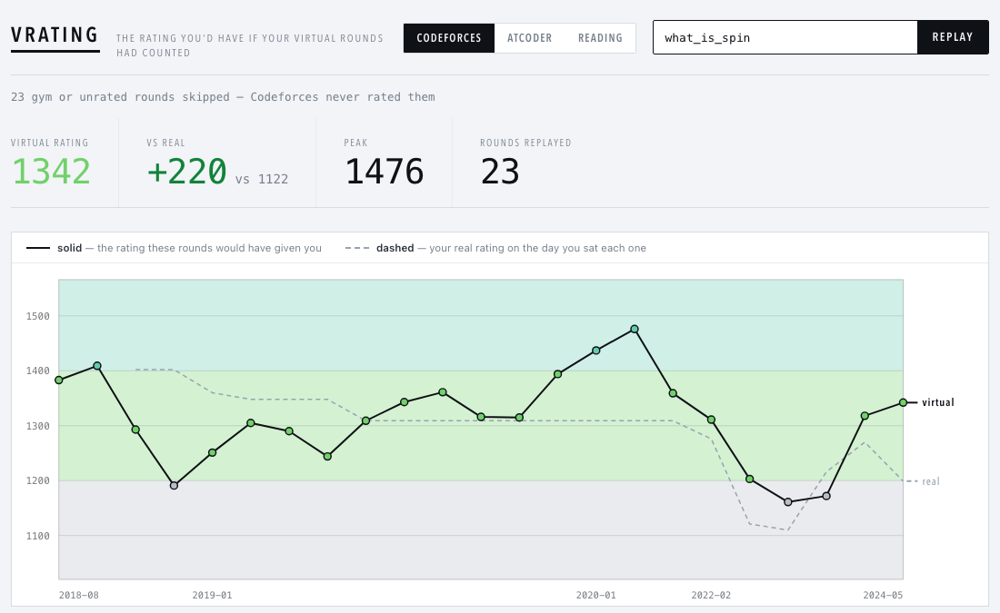
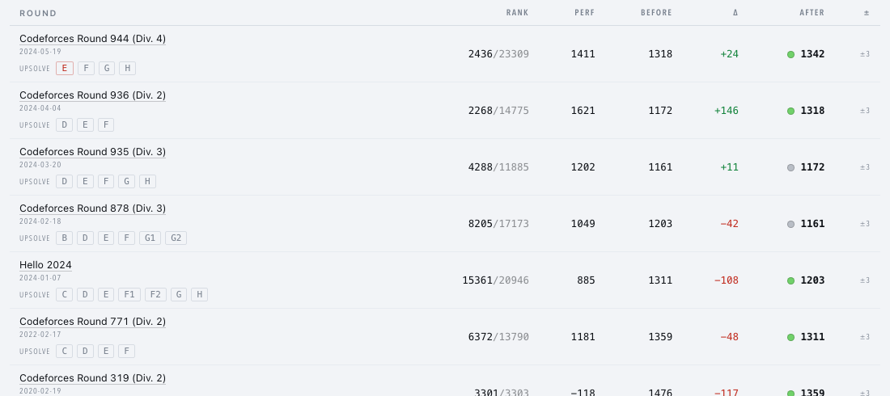

# vrating

**The rating you'd have if every virtual contest you've ever done had counted.**

You sit a virtual round on Codeforces, get a rank, and nothing happens — real practice with an
imaginary scoreboard. vrating replays those rounds against the field that actually sat them,
chains each result into the next, and draws the career you'd have had.

```bash
git clone git@github.com:TAOGenna/vrating.git && cd vrating
make dev
```

Python 3.10+ is the only prerequisite. The first run builds a virtualenv, installs numpy, and
opens the page.

To stop retyping your handles, name them once in `.env` (copy `.env.example`):

```
VRATING_HANDLES=your_handle, your_alt, an_older_account
```

Every entry point then starts from them — the page opens on that career, `make dev` warms
those contests, `make warm` fetches only what they have sat. Old handles are fine: Codeforces
renames are resolved, so a name you have since changed collapses into the account it became.
A handle in the URL still overrides, which is how you look somebody else up.



Solid line: the career your virtual rounds would have given you. Dashed: your real rating on
the day you sat each one. The gap between them is the point — above, `galen_colin` sits **258
points higher** in the timeline where his practice counted, peaking at 3076.

---

## Three things it does

### Replays your virtual rounds as if they were real

Every round is scored against the actual field — every rated participant's rating, their
scores, and the round's own published rating changes. Type a handle and it finds your virtual
participations itself. Give it several, comma separated, and the careers merge: alt accounts
are one person, a round sat twice counts once, and a problem upsolved on any of them counts
as upsolved. An account that has been renamed or deleted is reported and skipped rather than
taking the replay down with it.

Two framings, switchable: **virtual rounds only** — what your practice alone is worth, from
scratch — or **alongside your real contests**, one interleaved timeline answering what you
would be rated had practice counted too. The first can discard a lot on a long career: once
the from-scratch rating passes a division ceiling, later Div. 2 rounds stop counting.

Hover any round for its **alternate timeline**: where you would stand today had you skipped
it. galen_colin [made this argument by hand](https://codeforces.com/blog/entry/79415) for a
single −166 disaster, showing it had shrunk to a 25-point difference six rounds later. Running
it for every round at once is the honest answer to *"that one contest ruined my rating"* —
across his own 65 rated rounds, the costliest was worth **15 points**.

### Tells you what to upsolve



Each round carries its unsolved problems as links, with the ones you *attempted and failed*
marked apart from the ones you never opened. Beyond that, **What should I upsolve?** scans
every round you have ever sat and finds the problems most people *at your level* solved and
you didn't — grouped by tag, so you can see where the rust actually is.
