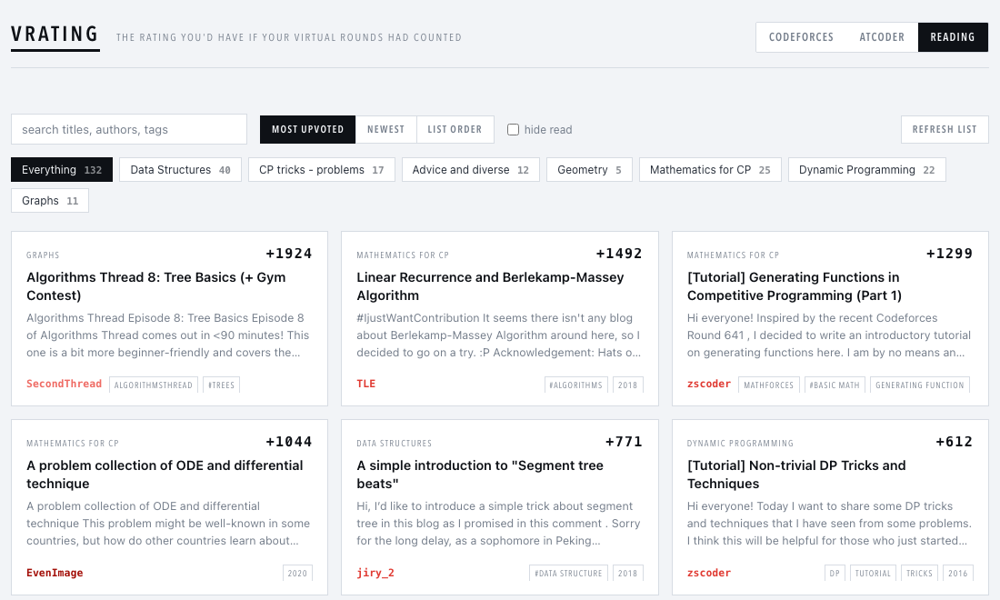

# vrating

**The rating you'd have if every virtual contest you've ever done had counted.**

You sit a virtual round on Codeforces, get a rank, and nothing happens — real practice with an
imaginary scoreboard. vrating replays those rounds against the field that actually sat them,
chains each result into the next, and draws the career you'd have had.

```bash
git clone git@github.com:TAOGenna/vrating.git && cd vrating
make dev
```

Python 3.10+ is the only prerequisite. The first run builds a virtualenv, installs numpy, and
opens the page.


Solid line: the career your virtual rounds would have given you. Dashed: your real rating on
the day you sat each one. The gap between them is the point — above, `galen_colin` sits **258
points higher** in the timeline where his practice counted, peaking at 3076.

---

## Three things it does

### Replays your virtual rounds as if they were real

Every round is scored against the actual field — every rated participant's rating, their
scores, and the round's own published rating changes. Type a handle and it finds your virtual
participations itself. Give it several, comma separated, and the careers merge: alt accounts
are one person, and a round sat twice counts once.

Hover any round for its **alternate timeline**: where you would stand today had you skipped
it. galen_colin [made this argument by hand](https://codeforces.com/blog/entry/79415) for a
single −166 disaster, showing it had shrunk to a 25-point difference six rounds later. Running
it for every round at once is the honest answer to *"that one contest ruined my rating"* —
across his own 65 rated rounds, the costliest was worth **15 points**.

### Tells you what to upsolve


Each round carries its unsolved problems as links, with the ones you *attempted and failed*
marked apart from the ones you never opened. Beyond that, **What should I upsolve?** scans
every round you have ever sat and finds the problems most people *at your level* solved and
you didn't — grouped by tag, so you can see where the rust actually is.

### Keeps a reading shelf



~130 blogs from
[TAOGenna/competitive-programming](https://github.com/TAOGenna/competitive-programming/tree/master/Interesting_blogs),
as cards. That list is titles and links only, so rather than invent descriptions the cards use
Codeforces' own metadata: the author's real title, their handle in rank colour, the tags, and
an excerpt from the post. Sorted by community score — the only measurable reading of "most
interesting" — with topic filters, search, and read state kept in your browser.

---

## Why the numbers can be trusted

Every layer was checked against each platform's own published results before it was used.

| | |
|---|---|
| Codeforces rating formula | **98–99% within ±1** on Div. 1 fields, 2023–2026 |
| Score reconstruction from submissions | **100% exact** vs official standings, 90 contestants |
| Per-problem scoring rule | **100% exact** across 120/150/180-minute rounds |
| AtCoder — 4 real careers, 125 contests | **every rating exact** |
| Whole pipeline: replay a *real* career as if virtual | lands **+4, −2, +3** off the real one |

That last row is the one that matters. Feed someone's genuine contest history through the
engine and it reproduces their actual rating curve — within four points after 57 rounds.

Typical per-round error is **about 1 rating point**. `make test` runs the offline suite,
`make test-all` includes the network-bound checks, and `tests/test_accuracy.py` holds the
error budgets as assertions so a regression fails the build.

### Two corrections do the work

**Codeforces hides a rating.** A new account *displays* 0 but is calculated at an internal
1400, closing the gap over six rounds via promotions of 500/350/250/150/100/50. The API
reports the displayed value, so in a Div. 2 field a large slice of the input is wrong.
Reconstructing the real one from the full rating archive took median error in the bottom band
from 10–14 points down to 1. Codeforces introduced this scheme at round 1360 — a date I pinned
from the archive itself — and before it accounts simply started at 1500. Both eras are handled.

**Codeforces publishes the answer.** Every participant's real delta is public, so the residual
against ours is observable. Fitting it per contest absorbs whatever the first correction
missed.

### AtCoder

AtCoder publishes each round's full rank-to-performance curve, so a rank converts to a
performance essentially exactly. Two details break naive implementations, both settled from
the data: APerf is a weighted average in `2^(perf/800)` space rather than linear, and the
rating uses the *capped* `Performance` field, not `InnerPerformance`.

Its one gap: `standings/json` needs a login, so the app finds the rounds you solved problems
from *after* they finished — what a virtual sitting looks like from outside — and you type the
rank.

---

## Speed

A warm replay is **0.27 s** of server time. Getting there:

- The seed is an FFT convolution and the binary search is vectorized across the whole field:
  full-field deltas for a 21k-participant contest went **8.0 s → 5.7 ms**.
- The two per-user API calls happen **in the browser**, not on the server. Codeforces serves
  them with CORS, so they run in parallel against your own rate-limit budget. Those were 3.5 s
  of a 3.7 s replay.
- Contest preparation is threaded while the chain stays sequential — numpy releases the GIL,
  so **3.9×** — and results still stream in order as they land.
- Failed standings fetches are tombstoned. Gym rounds have no rated field and the API refuses
  them; without remembering that, every upsolve scan re-attempted ~22 doomed requests at one
  per second. That alone was 22 s of a 30 s scan.

The cache fills itself as you use the app; `make warm H=your_handle` just moves that waiting
off your first page load.

---

## Commands

| | |
|---|---|
| `make dev` | start it and open the page |
| `make dev H=handle` | and warm that handle's contests first |
| `make test` / `make test-all` | offline suite / including network |
| `make warm H=handle` | warm without starting |
| `make clean` | drop the cache — it all re-fetches |

Environment: `VRATING_PORT`, `VRATING_DATA`, `VRATING_WORKERS` (threads, default 4),
`VRATING_CACHED_CONTESTS` (memory/speed trade, default 256).

## Known gaps

- AtCoder ranks are typed in; there is no public standings source to derive them from.
- Contests before ~2015 used a different rating system and are not modelled.
- Participants disqualified mid-contest (every submission `SKIPPED`) are not modelled. It
  cannot affect a virtual participant and never changes points or penalty.
- Team participations are excluded from fields.

The method, and how every number above was measured, is written up in
[docs/research.md](docs/research.md).
