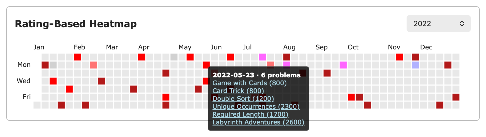
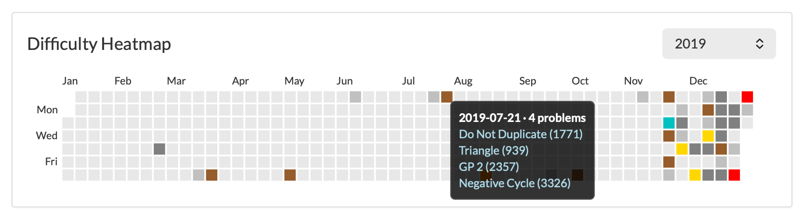

# cf-heatmap

A heatmap on every Codeforces profile where each day is coloured by the hardest problem you first solved that day, not by how many you solved. Hover a day to see its problems, with links. There is an [AtCoder version](#atcoder) too.

The Codeforces one is a Safari port of [Codeforces-Rating-Based-Heatmap-Extension](https://github.com/gopikrishna000/Codeforces-Rating-Based-Heatmap-Extension) (MIT, gopikrishna000), written as a userscript for the [Userscripts](https://apps.apple.com/app/userscripts/id1463298887) app, so it needs no Xcode. It also drops the 280 KB d3 dependency.

<p align="center">
  
</p>

## How a day is coloured

- **The maximum, not the average.** A day takes the tier of the hardest problem solved that day. An average would paint an 800 plus a 2000 as a 1400, a tier of problem you never solved, and it would punish warm-ups.
- **First solves only.** A problem you had already solved on an earlier day doesn't colour the day; it shows grey in the tooltip.
- **Unrated problems** (gym problems, or a contest whose ratings are not out yet) count as 0, so they can't raise a day's colour. The tooltip marks them "(unrated)".
- **Volume** isn't in the colour. The tooltip header says how many problems the day had, and lists them.

| Rating | Colour |
|:--|:--|
| 3000+ | dark red |
| 2600–2999 | red |
| 2400–2599 | light red |
| 2300–2399 | orange |
| 2100–2299 | light orange |
| 1900–2099 | purple |
| 1600–1899 | light blue |
| 1400–1599 | aqua |
| 1200–1399 | green |
| below 1200 | grey |

## AtCoder

`atcoder-rating-heatmap.user.js` is the same heatmap for `atcoder.jp/users/<handle>`, at the bottom of the profile's main column.

<p align="center">
  
</p>

AtCoder has no problem ratings, so the data comes from [AtCoder Problems](https://kenkoooo.com/atcoder) (an unofficial API by kenkoooo): every submission, plus its difficulty estimate for each problem. The rules are the ones above, with AtCoder's colours on the difficulty. Estimates under 400 are squeezed towards 0, as on that site, and a problem with no estimate counts as 0 and shows "(no difficulty)" in the tooltip.

| Difficulty | Colour |
|:--|:--|
| 4000+ | gold |
| 3600–3999 | silver |
| 3200–3599 | bronze |
| 2800–3199 | red |
| 2400–2799 | orange |
| 2000–2399 | yellow |
| 1600–1999 | blue |
| 1200–1599 | cyan |
| 800–1199 | green |
| 400–799 | brown |
| below 400 | grey |

It downloads all your submissions and about 2.4 MB of problem data on every profile load, so the heatmap appears a few seconds after the page.

## Install

```bash
cp cf-rating-heatmap.user.js atcoder-rating-heatmap.user.js ~/Library/Containers/com.userscripts.macos.Userscripts-Extension/Data/Documents/scripts/
```

Then click the Userscripts button in Safari's toolbar once so it registers the files, make sure the extension is switched on there, and open a `codeforces.com/profile/<handle>` or `atcoder.jp/users/<handle>` page. The AtCoder script fetches from `kenkoooo.com` through Userscripts, so if Safari asks to let Userscripts access that site, allow it.

## Check

```bash
node cf-rating-heatmap.user.js        # prints "self-check passed"
node atcoder-rating-heatmap.user.js   # prints "self-check passed"
```
