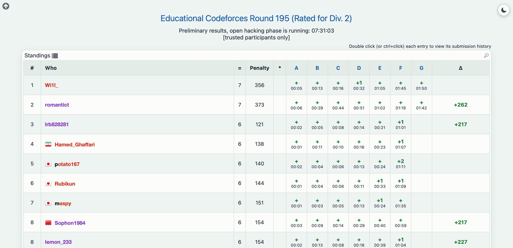

# cf-predictor

A Δ column on Codeforces standings that shows how much rating each contestant is about to gain or lose, while the contest is running or waiting for its rating changes. Once Codeforces has applied them, the column shows the real changes instead.

It is a Safari userscript for the [Userscripts](https://apps.apple.com/app/userscripts/id1463298887) app, and it needs no server. The old [CF-Predictor Safari guide](https://codeforces.com/blog/entry/118717) fetched every prediction from a backend that has since gone offline; this one runs the rating system in the browser, from Codeforces' own API.

<p align="center">
  
</p>

## How it works

1. Downloads the standings, and the rating of everyone in them (`user.ratedList`, plus `user.info` for anyone it doesn't list).
2. Drops the users above the contest's cap, since Educational, Div. 3 and Div. 4 list them as official but don't rate them: 2100 for Div. 2 and Educational, 1600 for Div. 3, 1400 for Div. 4.
3. Runs Codeforces' rating system, the version that matches production, as in [Carrot](https://github.com/meooow25/carrot) and [TLE](https://github.com/cheran-senthil/TLE): each contestant's expected rank, the geometric mean with their real rank, the rating that would have earned that rank, half the distance to it, then the two corrections that keep the field's total slightly negative. It is a port of [`vrating/rating/cf.py`](../vrating/rating/cf.py).
4. Accounts with no rated contest are read as 1400 and get the +500 their first contest adds on top.

## How accurate it is

Measured against the real rating changes of finished contests:

| Contest | Result |
|:--|:--|
| Div. 1 (1889, 2196) | 99% of contestants within ±1, 74–87% exact |
| Div. 2 (2064), rated 1600–2099 | median error 3, 92% within ±5 |
| Div. 2 (2064), rated 1200–1599 | median error 7 |
| Div. 2 (2064), rated below 1200 | median error 28 |
| Div. 2 (2064), first contest | median error 26 |

The error below 1600 is Codeforces' doing. An account's first six contests add +500, +350, +250, +150, +100 and +50 to the rating change, and its rating is higher internally than what the API shows until then. The API doesn't say how many contests an account has done, so only the first contest is recognisable (no rating at all). Everything after it is read as an established account.

Codeforces also removes cheaters after the contest and before applying the changes, which moves everyone's rank. The prediction can't know who is next, and the bigger the field, the more it matters.

## Install

```bash
cp cf-rating-predictor.user.js ~/Library/Containers/com.userscripts.macos.Userscripts-Extension/Data/Documents/scripts/
```

Then click the Userscripts button in Safari's toolbar once so it registers the file, make sure the extension is switched on there, and open any `codeforces.com/contest/<id>/standings` page. The column shows `Δ…` while it loads and `Δ` when it's done; if it shows `Δ!`, hover it for the error.

It downloads the whole standings and a 16 MB rating list on every load, so the column appears some seconds after the page: 11–16 seconds for a 7,700-contestant Educational round. If Codeforces answers "call limit exceeded", it waits and retries.

## Check

```bash
node cf-rating-predictor.user.js   # prints "self-check passed"
```

The check compares the port against the Python implementation on a small field, including a tie.
