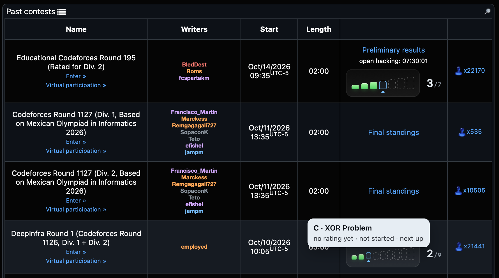

# cf-progress

A skyline in the status cell of Codeforces' contests table: one bar for each problem of every contest you have submitted to, filled by what you did with it. It replaces the grey "Solved: 3 out of 7" line.

It is a Safari userscript for the [Userscripts](https://apps.apple.com/app/userscripts/id1463298887) app and needs no server. It works in the light and the dark theme.

<p align="center">
  
</p>

## What a strip shows

- **Height.** A bar is as tall as its problem's rating, from 800 to 3000, so a Div. 4 round is a low row and a Div. 1 round a tall one. A contest whose problems have no rating yet gets an even staircase.
- **Fill.**
  - Solid green: solved in the contest.
  - Hatched mint: solved later, in a virtual contest or as practice.
  - Amber outline: tried, not solved yet.
  - Dashed outline: not started.
- **Next up.** The first unsolved bar has a caret under it.
- **Count.** `3/7` beside the strip. When every problem is solved the strip gets a gold ring and a "Cleared" seal.
- **Hover** a bar for the problem, its rating and when you solved it, or how many attempts it has. **Click** it to open the problem.

Rows for contests you have not submitted to are left as Codeforces draws them.

## How it works

1. Reads your handle from the page header, so you need to be logged in.
2. Downloads your submissions (`user.status`) and the problem list (`problemset.problems`), about 3.5 MB together. A submission says whether it was made during the contest, in a virtual contest or as practice, which is how solved in contest and solved later are told apart.
3. Keeps the result in `localStorage` for ten minutes, so moving through the contests pages only downloads once.
4. Draws a strip in each row that has a standings link. When the page says "out of 7", that total is used, because very recent contests list only some of their problems in the problemset.

## Install

```bash
cp cf-contest-progress.user.js ~/Library/Containers/com.userscripts.macos.Userscripts-Extension/Data/Documents/scripts/
```

Then click the Userscripts button in Safari's toolbar once so it registers the file, make sure the extension is switched on there, and open `codeforces.com/contests`.

## Check

```bash
node cf-contest-progress.user.js   # prints "self-check passed"
```

The check covers the states, the problems you submitted to that the problemset doesn't list yet, the gym filter, the bar heights and the page-total parsing.
