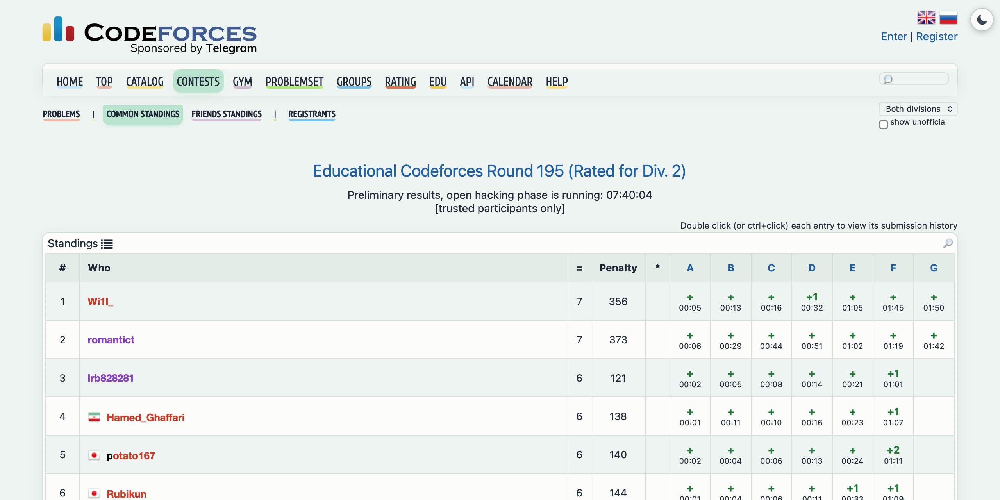
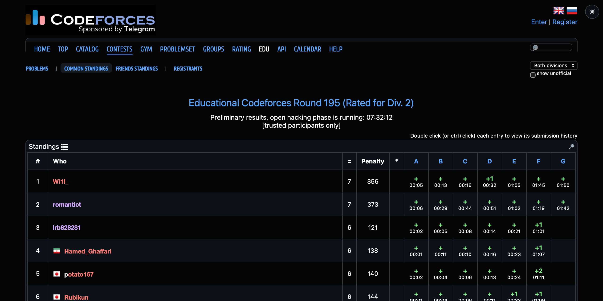

# cf-theme

A dark and a light theme for Codeforces, with a button to switch between them. It is a Safari userscript for the [Userscripts](https://apps.apple.com/app/userscripts/id1463298887) app, so it needs no Xcode.

<p align="center">
  
</p>

<p align="center">
  
</p>

## The two themes

- **Dark** is the default: a near-black page with GitHub-style greys and blues.
- **Light** is a calmer paper look: a pale sage page, warm off-white cards and slate text. The menus get a short pastel bar under each item. Hovering an item grows its bar into a pill, and the current item is filled.
- **The switch** is the round ☀ / ☾ button in the top-right corner. It saves your choice and reloads the page.

## Colours that Codeforces gets wrong in a dark page

Dark themes usually force one text colour on everything, which wipes out the colours that carry meaning. This one puts them back, in both themes:

- Handles keep their rank colours, from gray to red.
- In the standings, `+` is green and `-x` is red.
- In submissions, Accepted is green and a rejected verdict is red, with its test number in the same colour.

## Install

```bash
cp codeforces-theme.user.js ~/Library/Containers/com.userscripts.macos.Userscripts-Extension/Data/Documents/scripts/
```

Then click the Userscripts button in Safari's toolbar once so it registers the file, and make sure the extension is switched on there. [cf-predictor](../cf-predictor/) and [cf-progress](../cf-progress/) pick up whichever theme is active.

## Credit

It starts from *Codeforces Ultimate Dark Theme* by Nerdblud. The light theme, the switch, the menu bars, the rank colours and the standings and verdict colours are additions.
